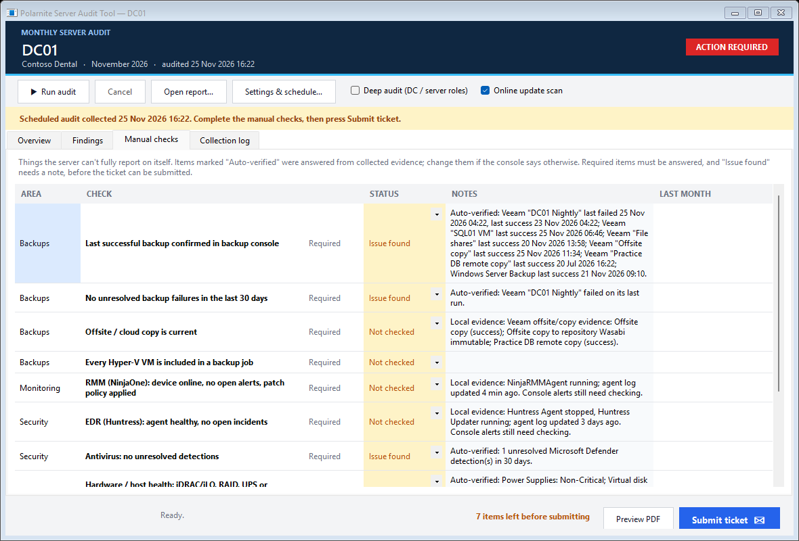

# Polarnite Server Audit Tool (Windows app)

`dist/PolarniteServerAuditTool.exe` is a single file for monthly server maintenance tickets. It works on Windows Server 2012 R2 and later, and on Windows 10/11 PCs that a client uses as a server. It:

1. Runs the repository's read-only collector, [`Export-WinFixAudit.ps1`](../Export-WinFixAudit.ps1), which is embedded in the exe.
2. Turns the evidence into **findings** (critical / warning / info / pass).
3. Lets the technician fill in what a script can't check: backup console, NinjaOne, Huntress, antivirus, hardware, MFA and exposure.
4. Builds a branded **PDF report** and emails a **summary ticket** with the PDF attached to `support@polarnite.com`:
   `Monthly Server Audit - <tenant> - <server> - <month>`

It needs nothing installed on the server beyond .NET Framework 4.5+ and Windows PowerShell 4+, which come with Windows Server 2012 R2 and later.

### What it checks

- **Patching and lifecycle:** missing and failed updates, last install, pending restart, uptime, OS support dates, update service and source.
- **Security:** required agents (NinjaOne, Huntress), Defender status, signatures and detection history, firewall, RDP/NLA, SMBv1/signing, BitLocker, Secure Boot/TPM, TLS/SSL protocols, LLMNR/NetBIOS, WDigest, NTLM level, LSA protection, PowerShell 2.0, LAPS, open shares, remote-access tools, failed logons, certificates expiring within 60 days and, if enabled, internet exposure (Shodan InternetDB).
- **Backups:**
  - *Veeam:* job results from the event log on every server; on a Backup & Replication server also each job's schedule (manual-only jobs are not flagged), last result and restore points, backup copy jobs that have stopped, repository free space and licence expiry (60 days ahead).
  - *Synology Active Backup for Business:* agent service, the start and finish of each backup run from the agent log (`backup-job.cpp … in backup routine, has_fail_volume`), failed runs, runs that never finished, and NAS connection errors. The expected interval is learned from past runs, so weekly schedules are not flagged as missed.
  - *Synology Drive Client:* whether it is running (it only runs while a user is signed in) and errors after its last success.
  - *OneDrive:* per user, which folders are in OneDrive (Known Folder Move) and when it last synced, flagged when a user signs in but OneDrive has stopped.
  - Windows Server Backup, backup tasks, VSS writers, backup and VSS errors, Hyper-V checkpoints and replication.
- **Storage and hardware:** drive space and growth forecast, disk health, Dell OpenManage / HPE Smart Storage status, hardware and disk error events, unexpected shutdowns.
- **Accounts and AD:** Administrators membership and changes, password and lockout policy, local accounts; on domain controllers stale users/computers, never-expiring passwords, unsupported OS, krbtgt age, Recycle Bin, dcdiag and replication.
- **System:** Windows activation and Extended Security Updates (ESU) licences, time sync, key services, critical event-log errors.
- **Software support:** installed Office, Exchange, SQL Server, SharePoint, Acrobat, Java, Python 2 and QuickBooks versions that are out of support or within a year of it.
- **Windows 10/11 used as a server:** sleep and hibernate on AC power, automatic sign-in (and a password stored in the registry), UAC, paused or deferred Windows Update, fast startup, Home edition, LTSC support dates, and Windows 11 hardware readiness (TPM 2.0, Secure Boot).

### How findings are rated

| Rating | Meaning |
| --- | --- |
| **Critical** | Needs a fix ticket. Listed first on the cover page and in the email under *Needs a ticket*, together with any manual check a technician marked *Issue found*. |
| **Warning** | Noted for the record; fixed during normal maintenance. No ticket. |
| **Best practice** | Hardening and hygiene recommendations (for example krbtgt age, lockout policy, NTLM level, BitLocker, LLMNR). No ticket. |

To move a rule between tiers, edit `BestPracticeKeys` / `TicketKeys` in `src\Analyzer.cs` (or the severity where the finding is added).

### Auto-verified manual checks

When the evidence is there, the app answers manual checks itself and marks the note **Auto-verified**:
antivirus detections (Defender), last successful backup and unresolved failures (Veeam events and console, Synology Active Backup, Windows Server Backup),
hardware health (vendor tools, or N/A on a VM), OS support entitlement (an activated ESU licence) and internet exposure (when enabled).
A technician can change any of them, and the technician's answer always wins.
For NinjaOne and Huntress the app adds the local agent state as a hint, because open alerts are only visible in the console.
Synology Drive and OneDrive results, and Veeam backup copy jobs, are added as hints to the backup checks rather than answered.
Restore tests are not part of the checklist.

### Compared with last month

Each audit is compared with the last submitted one. The PDF gets a *Changes since the last audit* section, and findings that are new are marked **NEW**. It covers:
critical/warning counts, new and resolved findings, a disk-full forecast per drive, administrators added or removed, software installed or removed
(new remote-access tools are flagged) and new listening ports.

| Manual checks | Sample report |
| --- | --- |
|  | [Sample-Report-DC01.pdf](docs/Sample-Report-DC01.pdf) (fictional server), [Sample-Report-FRONTDESK-PC.pdf](docs/Sample-Report-FRONTDESK-PC.pdf) (Windows 10 PC used as a server) and the [ticket email](docs/ticket-email.png) |

## Using it on a server

1. Copy `dist\PolarniteServerAuditTool.exe` to the server and run it. It asks for administrator rights.
2. First time only: **Settings & schedule…**
   - SMTP server, port (587 + STARTTLS, or 25 for a relay), username/password, From address.
     **Send test email** checks the settings.
   - Optional: **Create / update schedule** sets up a monthly run (day 1–28, time).
   - Optional: **Internet exposure check**. It sends the site's public IP to ipify.org and Shodan InternetDB, so it is off by default.
3. **Run audit** (3–10 minutes). Progress shows in *Collection log*.
4. Review **Findings**. You can add a technician note to any finding; notes appear in the PDF and the email.
5. Complete **Manual checks**. Required items must be answered, and *Issue found* needs a note.
6. Check **Overview**: tenant/client name (pre-filled from Entra tenant or AD domain), technician, server role and summary notes.
7. **Preview PDF** if you like, then **Submit ticket**. The button shows how many items are left until the ticket is complete.

### Scheduled runs

The scheduled task runs as SYSTEM and **only collects**. It saves the result as a draft and sends nothing.
The next time a technician opens the app, the draft loads with a yellow banner. Complete the manual
checks and press **Submit ticket**. Last month's notes are pre-filled; statuses reset to *Not checked*.

## Where things are kept

`C:\ProgramData\PolarniteServerAudit` (access limited to Administrators and SYSTEM):

| Path | Contents |
| --- | --- |
| `settings.json` | SMTP and ticket settings. The SMTP password is encrypted with machine-scoped DPAPI. |
| `state\current.json` | The current month's draft: answers, notes and status. |
| `state\last-answers.json`, `state\history\` | Last submission (used for next month's pre-fill) and a copy of every submission. |
| `runs\<timestamp>\` | Collector JSON plus the PDF sent. Runs older than 6 months are pruned. |
| `logs\app-YYYY-MM.log` | App and scheduled-run log. |
| `bin\PolarniteServerAuditTool.exe` | Copy used by the scheduled task `\Polarnite\Monthly Server Audit`. |

## Building

```powershell
cd app
.\build.ps1
```

This uses the C# compiler included in .NET Framework 4.x (`csc.exe`). No Visual Studio or NuGet is needed. It embeds
`..\Export-WinFixAudit.ps1` and writes `dist\PolarniteServerAuditTool.exe`.
**Rebuild and commit the exe whenever the collector changes**, so the binary in `dist` matches the script.

### Testing without a server

```powershell
cd app
.\tests\New-SampleAudit.ps1 -PreviousMonth        # last month's audit of the same fictional server
.\tests\New-SampleAudit.ps1                       # this month's, with planted issues
.\tests\New-SampleAudit.ps1 -Workstation          # a Windows 10 PC used as a server
.\build.ps1 -AsInvoker -Output .\test-build\app.exe
$env:POLARNITE_AUDIT_DATA = "$env:TEMP\wfa-test"  # keep test state out of ProgramData
$reports = Get-ChildItem .\tests\sample\*.json | Sort-Object Name
.\test-build\app.exe --render $reports[1].FullName $env:TEMP\wfa-out $reports[0].FullName   # 3rd path (optional): previous audit
```

`--render` builds the PDF, the email bodies and an `.eml` file (in `mail\`) instead of sending anything.
`--screenshot <report.json> <dir>` saves PNGs of the main window.
Keep test folders short: .NET Framework rejects paths over 260 characters.

## Customising

- **Required agents** (Settings): comma-separated service names, default `Ninja, Huntress`. A missing or stopped agent is a critical finding.
- **Manual check list**: `ManualCatalog.Items` in `src\Model.cs` (title, guidance, required, and when it applies).
- **Rules and thresholds**: `src\Analyzer.cs`. Examples: drive space below 20% is a warning and below 10% is critical. A restart is due after 35 days. Defender signatures older than 3 days are a warning and older than 7 days are critical. Updates not installed for 35 days are a warning and 60 days is critical.
- **OS lifecycle dates**: `Lifecycle()` in `src\Analyzer.cs`. Check them against Microsoft's lifecycle pages from time to time.

### Renamed from WinFix Server Audit

The first time the renamed app runs on a server, it moves `C:\ProgramData\WinFixAudit` to `C:\ProgramData\PolarniteServerAudit`
(settings, saved SMTP password, drafts and history) and replaces the `\WinFix\Monthly Server Audit` task with `\Polarnite\Monthly Server Audit`.

## Notes and limits

- Missing data is never counted as a pass. Checks that fail or time out are listed under *Collection coverage* at the end of the PDF.
- SMTP port 465 (implicit TLS) is not supported by .NET's mail client. Use 587/STARTTLS or a port-25 relay.
- The exe is unsigned, and it starts `powershell.exe -ExecutionPolicy Bypass` to run the embedded collector. EDR tools (including Huntress) may flag this. Sign the exe, or allow-list its hash, before a wide rollout.
- Synology Active Backup results come from the agent's local log (about five days of rotated `log.txt_N` files plus older runs if still present). The NAS console is the source of truth for retention.
- The PDF uses the built-in Helvetica fonts (Western European characters). Other characters print as `?`.
